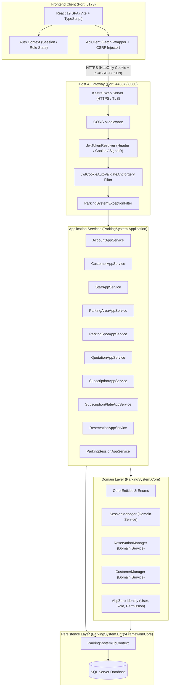
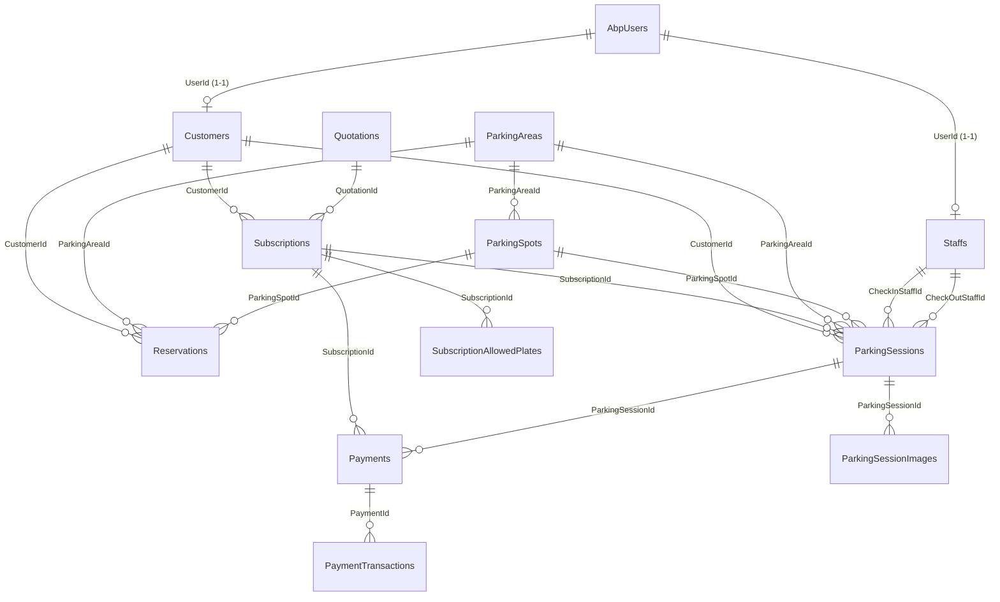
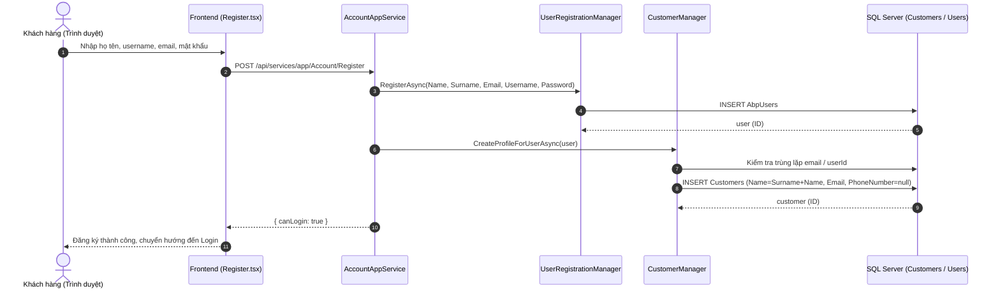
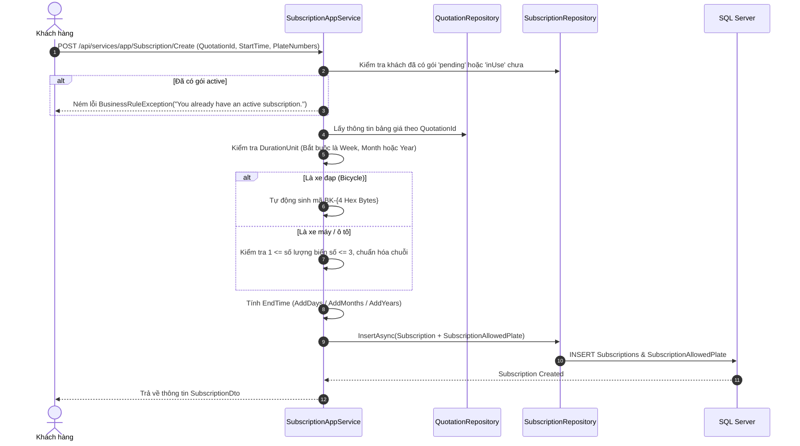
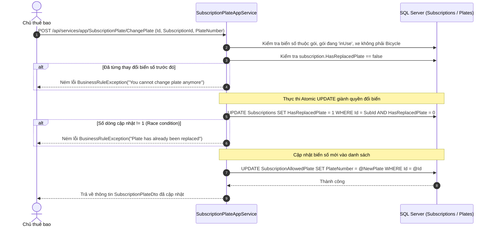
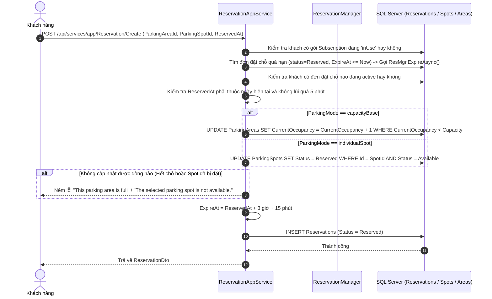
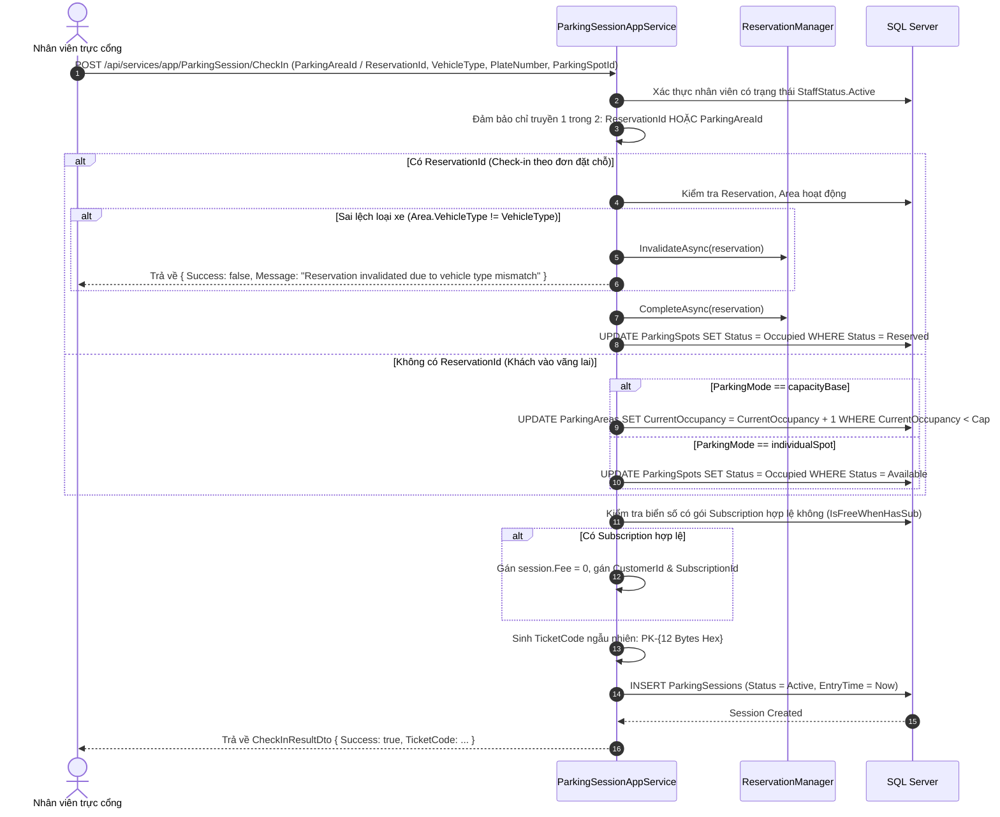

# BÁO CÁO PHÂN TÍCH TOÀN DIỆN SOURCE CODE DỰ ÁN PARKING SYSTEM
## Tài Liệu Kỹ Thuật Phục Vụ Viết Báo Cáo Thực Tập Doanh Nghiệp

> **Người thực hiện:** Senior Software Engineer  
> **Dự án:** Hệ thống Quản lý Bãi đỗ xe Thông minh (Parking Management System)  
> **Căn cứ phân tích:** Toàn bộ mã nguồn thực tế tại kho lưu trữ (Backend, Frontend, Database Migrations, Tests, Cấu hình)  
> **Ngày lập báo cáo:** 24/10/2026  

---

## MỤC LỤC

1. [TỔNG QUAN HỆ THỐNG VÀ BẢNG ĐỐI CHIẾU TÀI LIỆU CŨ](#1-tổng-quan-hệ-thống-và-bảng-đối-chiếu-tài-liệu-cũ)
   - 1.1. Bối cảnh và mục tiêu phân tích
   - 1.2. Bảng đối chiếu giữa tài liệu cũ (`README.md`) và mã nguồn thực tế
2. [KIẾN TRÚC TỔNG THỂ HỆ THỐNG](#2-kiến-trúc-tổng-thể-hệ-thống)
   - 2.1. Mô hình kiến trúc 3 tầng (Backend – Frontend – Database)
   - 2.2. Kiến trúc Backend: N-Layer Domain Driven Design (DDD) trên ABP Framework
   - 2.3. Kiến trúc Frontend: React SPA hiện đại
   - 2.4. Kiến trúc Container hóa và Môi trường chạy (Docker)
3. [MÔ HÌNH DỮ LIỆU VÀ CÁC THỰC THỂ (ENTITIES)](#3-mô-hình-dữ-liệu-và-các-thực-thể-entities)
   - 3.1. Danh mục Enums cốt lõi
   - 3.2. Chi tiết các Entity và Cấu hình DbContext
   - 3.3. Sơ đồ quan hệ dữ liệu (ERD) và ràng buộc toàn vẹn
4. [PHÂN TÍCH CHI TIẾT CÁC MODULE NGHIỆP VỤ BACKEND](#4-phân-tích-chi-tiết-các-module-nghiệp-vụ-backend)
   - 4.1. Module Customer & Tự động tạo hồ sơ khách hàng
   - 4.2. Module Staff & Ràng buộc ca trực
   - 4.3. Module ParkingArea (Bãi đỗ xe) & Hai chế độ vận hành
   - 4.4. Module ParkingSpot (Vị trí đỗ xe)
   - 4.5. Module Quotation (Bảng giá dịch vụ)
   - 4.6. Module Subscription (Gói gửi xe định kỳ)
   - 4.7. Module SubscriptionAllowedPlate (Quản lý biển số xe theo gói)
   - 4.8. Module Reservation (Đặt chỗ trước)
   - 4.9. Module ParkingSession (Phiên đỗ xe thực tế)
   - 4.10. Module Payment & PaymentTransaction (Khảo sát thực tế)
5. [MÔ TẢ CHI TIẾT CÁC LUỒNG NGHIỆP VỤ THEO CODE THỰC TẾ](#5-mô-tả-chi-tiết-các-luồng-nghiệp-vụ-theo-code-thực-tế)
   - 5.1. Luồng Đăng ký tài khoản và Khởi tạo hồ sơ Customer
   - 5.2. Luồng Mua gói dịch vụ gửi xe (Subscription)
   - 5.3. Luồng Thay đổi / Thêm mới biển số xe (Plate Management)
   - 5.4. Luồng Đặt chỗ đỗ xe trước (Reservation)
   - 5.5. Luồng Xe vào bãi (Check-In)
   - 5.6. Luồng Xe ra bãi và Tính phí đỗ (Check-Out)
   - 5.7. Luồng Thanh toán và Giao dịch (Payment Workflow)
6. [BẢO MẬT, XÁC THỰC VÀ PHÂN QUYỀN](#6-bảo-mật-xác-thực-và-phân-quyền)
   - 6.1. Cơ chế xác thực kép (Hybrid Authentication: JWT Bearer & HttpOnly Cookie)
   - 6.2. Cơ chế phòng chống tấn công CSRF (Double-Submit / Antiforgery Cookie Filter)
   - 6.3. Hệ thống Role và Permission Tree
   - 6.4. Cơ chế kiểm soát sở hữu dữ liệu (Ownership Check)
   - 6.5. Xử lý tập trung ngoại lệ (Exception Handling & Error Masking)
7. [KIẾN TRÚC VÀ HIỆN TRẠNG FRONTEND REACT](#7-kiến-trúc-và-hiện-trạng-frontend-react)
   - 7.1. Cấu trúc thư mục mã nguồn Frontend
   - 7.2. Quản lý trạng thái và phiên đăng nhập (`AuthContext`)
   - 7.3. Cơ chế giao tiếp API (`apiClient.ts` & Services)
   - 7.4. Hệ thống định tuyến và phân quyền Route (`App.tsx`)
   - 7.5. Khảo sát chi tiết các màn hình giao diện đã triển khai
8. [CÁC QUY TẮC NGHIỆP VỤ VÀ CƠ CHẾ XỬ LÝ ĐỒNG THỜI (CONCURRENCY)](#8-các-quy-tắc-nghiệp-vụ-và-cơ-chế-xử-lý-đồng-thời-concurrency)
   - 8.1. Các quy tắc nghiệp vụ bất biến (Business Invariants)
   - 8.2. Cơ chế xử lý đồng thời mức Database (Atomic SQL Updates / CAS Pattern)
   - 8.3. Khóa bi quan chống Race Condition (`UPDLOCK, HOLDLOCK`)
   - 8.4. Bắt mã lỗi SQL Server và chuyển dịch biệt lệ nghiệp vụ
9. [ĐÁNH GIÁ VÀ TỔNG HỢP HIỆN TRẠNG KIỂM THỬ (TESTING)](#9-đánh-giá-và-tổng-hợp-hiện-trạng-kiểm-thử-testing)
   - 9.1. Danh mục các bài kiểm thử tự động hiện có
   - 9.2. Ma trận đối chiếu phạm vi kiểm thử (Coverage Gap Analysis)
10. [BẢNG PHÂN LOẠI TRẠNG THÁI TÍNH NĂNG TOÀN DỰ ÁN](#10-bảng-phân-loại-trạng-thái-tính-năng-toàn-dự-án)
11. [KẾT LUẬN VÀ KHUYẾN NGHỊ CHO BÁO CÁO THỰC TẬP](#11-kết-luận-và-khuyến-nghị-cho-báo-cáo-thực-tập)

---

## 1. TỔNG QUAN HỆ THỐNG VÀ BẢNG ĐỐI CHIẾU TÀI LIỆU CŨ

### 1.1. Bối cảnh và mục tiêu phân tích
Hệ thống **ParkingSystem** là một giải pháp quản lý bãi đỗ xe thông minh, hướng tới tự động hóa quy trình quản lý vé gửi xe, đặt chỗ trước, quản lý thuê bao gửi xe định kỳ, giám sát trạng thái chỗ đỗ theo thời gian thực và quản lý nhân viên/khách hàng.

Mục tiêu của tài liệu này là cung cấp bức tranh chân thực, khách quan và chuẩn xác 100% dựa trên mã nguồn thực tế đang tồn tại trong repository, tách bạch rõ ràng giữa:
- Những gì **đã được cài đặt hoàn thiện và sẵn sàng hoạt động**.
- Những gì **mới dừng lại ở tầng Database Schema / Entity** nhưng chưa có API.
- Những gì **Frontend mới chỉ dựng giao diện tĩnh (mockup)** chưa tích hợp API.
- Những gì **hoàn toàn chưa được phát triển**.

### 1.2. Bảng đối chiếu giữa tài liệu cũ (`README.md`) và mã nguồn thực tế

Quá trình khảo sát phát hiện tài liệu `README.md` tại thư mục gốc của dự án phản ánh cấu trúc của template khởi tạo ban đầu, **không còn phản ánh đúng hiện trạng kiến trúc và công nghệ thực tế** của dự án hiện tại.

| Hạng mục so sánh | Mô tả trong tài liệu cũ (`README.md`) | Thực tế trong mã nguồn dự án | Căn cứ mã nguồn kiểm chứng |
| :--- | :--- | :--- | :--- |
| **Công nghệ Frontend UI** | ASP.NET Core MVC, Razor Pages, AdminLTE 3, Bootstrap 4, jQuery | **React 19.2**, TypeScript, Vite 8, React Router v7, React-Bootstrap / Bootstrap 5, Sass | `Parking-System-Frontend/package.json`<br>`Parking-System-Frontend/vite.config.ts` |
| **Cấu trúc Solution Backend** | Liệt kê có project `ParkingSystem.Web.Mvc` đảm nhận giao diện web chính | **Không tồn tại** project `ParkingSystem.Web.Mvc`. Backend hoàn toàn phân tách thành RESTful API Headless qua `ParkingSystem.Web.Host` | `ParkingSystem.sln`<br>Thư mục `Parking-System-Backend/src` |
| **Vai trò Backend API** | `ParkingSystem.Web.Host` chỉ đóng vai trò phụ cho Mobile/Swagger | `ParkingSystem.Web.Host` là **máy chủ API duy nhất** phục vụ toàn bộ ứng dụng web React | `ParkingSystem.Web.Host/Startup/Startup.cs`<br>`ParkingSystem.Web.Host/Dockerfile` |
| **Cơ chế xác thực Client** | Session Cookie truyền thống của ASP.NET Core MVC | **Hybrid Token/Cookie**: Hỗ trợ đồng thời Bearer JWT và HttpOnly Cookie kèm CSRF Token | `ParkingSystem.Web.Core/Controllers/TokenAuthController.cs`<br>`ParkingSystem.Web.Host/Startup/AuthConfigurer.cs` |
| **Container hóa** | Không đề cập đến Docker | Đã có Dockerfile multi-stage build và file `docker-compose.yml` cấu hình HTTPS certificate và network | `Parking-System-Backend/src/docker-compose.yml`<br>`ParkingSystem.Web.Host/Dockerfile` |

---

## 2. KIẾN TRÚC TỔNG THỂ HỆ THỐNG

### 2.1. Mô hình kiến trúc 3 tầng (Backend – Frontend – Database)



### 2.2. Kiến trúc Backend: N-Layer Domain Driven Design (DDD) trên ABP Framework
Backend được xây dựng trên nền tảng **.NET 9.0** kết hợp với **ASP.NET Boilerplate (ABP Framework v10.x)**:

1. **`ParkingSystem.Core` (Domain Layer):**
   - Chứa định nghĩa các nghiệp vụ cốt lõi không phụ thuộc vào tầng ngoài.
   - Các thực thể kế thừa `Entity<long>`, triển khai các interface chuẩn của ABP: `IHasCreationTime`, `IHasModificationTime`, `ISoftDelete`.
   - Các Domain Service chịu trách nhiệm điều phối quy tắc bất biến: `SessionManager` (`ParkingSessions/SessionManager.cs`), `ReservationManager` (`Reservations/ReservationManager.cs`), `CustomerManager` (`Customers/CustomerManager.cs`).
   - Cấu hình phân quyền động và định nghĩa Permission Tree (`Authorization/ParkingSystemAuthorizationProvider.cs`).
   - Các Custom Data Annotation Attribute kiểm tra hợp lệ dữ liệu: `[PhoneNumber]`, `[Email]`, `[GreaterThanZero]`, `[NotPast]`, `[NotFuture]`.

2. **`ParkingSystem.Application` (Application Layer):**
   - Chứa các Application Service thực hiện các Use Cases của hệ thống.
   - Đa số các CRUD service kế thừa `AsyncCrudAppService<TEntity, TEntityDto, long, ...>` kết hợp ghi đè logic: lọc nâng cao (`CreateFilteredQuery`), sắp xếp động (`ApplySorting`), phân quyền sở hữu.
   - Các Service tùy biến logic phức tạp: `ParkingSessionAppService`, `SubscriptionAppService`, `SubscriptionPlateAppService`, `ReservationAppService`.
   - Chuyển đổi dữ liệu tự động giữa Entity và DTO thông qua AutoMapper profiles.

3. **`ParkingSystem.EntityFrameworkCore` (Infrastructure Layer):**
   - Quản trị kết nối cơ sở dữ liệu và cấu hình quan hệ thực thể qua `ParkingSystemDbContext` (kế thừa `AbpZeroDbContext<Tenant, Role, User, ParkingSystemDbContext>`).
   - Sử dụng Fluent API để thiết lập khóa ngoại, chỉ mục lọc duy nhất (`Filtered Unique Index`), độ chính xác số học (`HasPrecision(18, 2)`).
   - Quản lý toàn bộ lịch sử tiến hóa schema thông qua Entity Framework Core Migrations.

4. **`ParkingSystem.Web.Core` (Web Engine Layer):**
   - Điều khiển cơ chế xác thực đăng nhập qua `TokenAuthController`.
   - Tùy biến bộ xử lý giải quyết JWT từ Cookie / Header qua `JwtTokenMiddleware`.
   - Cài đặt bộ lọc chống giả mạo request `JwtCookieAutoValidateAntiforgeryTokenAuthorizationFilter`.
   - Cài đặt bộ lọc ngoại lệ `ParkingSystemExceptionFilter` để chuẩn hóa lỗi trả về client.

5. **`ParkingSystem.Web.Host` (Hosting Layer):**
   - Điểm kích hoạt ứng dụng ASP.NET Core (`Program.cs`, `Startup.cs`).
   - Tích hợp Swagger / OpenAPI document generator hỗ trợ kiểm thử API.
   - Cấu hình CORS cho phép các origin của React SPA kết nối và truyền nhận cookie an toàn (`AllowCredentials`).

### 2.3. Kiến trúc Frontend: React SPA hiện đại
- **Nền tảng:** React 19.2, TypeScript 5.8+, công cụ đóng gói Vite 8.
- **Tổ chức giao diện:** Bootstrap 5.3 + React-Bootstrap kết hợp tùy biến SCSS chuyên sâu (`dashboard.scss`, `filters.scss`, `customer-profile.scss`).
- **Quản lý phiên & CSRF:** Cơ chế quản trị token tự động trong `apiClient.ts`:
  - Đăng nhập qua `/api/TokenAuth/BrowserAuthenticate` giúp nhận HttpOnly cookie `access_token` và cookie `XSRF-TOKEN`.
  - Bộ chặn (Interceptor) tự động đính kèm `X-XSRF-TOKEN` vào HTTP Header đối với mọi yêu cầu thay đổi dữ liệu (POST, PUT, DELETE).
  - Tự động bắt sự kiện `parking:auth-unauthorized` khi phiên hết hạn để chuyển hướng về trang đăng nhập.

### 2.4. Kiến trúc Container hóa và Môi trường chạy (Docker)
- **Tệp cấu hình:** `ParkingSystem.Web.Host/Dockerfile` và `src/docker-compose.yml`.
- **Đặc điểm triển khai:**
  - Multi-stage build (Stage 1: SDK .NET 9.0 build/publish; Stage 2: ASP.NET 9.0 Runtime nhỏ gọn).
  - Chạy dưới tài khoản không đặc quyền (`USER $APP_UID`) để tăng cường bảo mật container.
  - Hỗ trợ mount chứng chỉ SSL tự ký (`.pfx`) cho môi trường Development qua biến môi trường `CERT_PASSWORD` và volume mount.
  - Expose cổng `44337` (HTTPS) và `8080/80` (HTTP).

---

## 3. MÔ HÌNH DỮ LIỆU VÀ CÁC THỰC THỂ (ENTITIES)

### 3.1. Danh mục Enums cốt lõi
*(Căn cứ file: `ParkingSystem.Core/Entities/Enums/*.cs`)*

| Tên Enum | Giá trị nguyên | Ý nghĩa nghiệp vụ | File định nghĩa |
| :--- | :--- | :--- | :--- |
| `VehicleType` | `1`: Bicycle, `2`: ElectricBicycle, `3`: Motorcycle, `4`: ElectricMotorcycle, `5`: Car | Phân loại phương tiện gửi xe | `VehicleType.cs` |
| `ParkingMode` | `0`: individualSpot, `1`: capacityBase | Chế độ quản lý: chọn vị trí cụ thể (ô tô) hoặc quản lý theo tổng sức chứa (xe máy, xe đạp) | `ParkingMode.cs` |
| `ParkingAreaStatus`| `0`: Inactive, `1`: Active | Trạng thái hoạt động của khu vực bãi xe | `ParkingAreaStatus.cs` |
| `ParkingSpotStatus`| `1`: Available, `2`: Reserved, `3`: Occupied, `4`: Unavailable | Trạng thái chỗ đỗ: Trống, Đã đặt, Đang đỗ, Tạm khóa | `ParkingSpotStatus.cs` |
| `DurationUnit` | `1`: Hour, `2`: Day, `3`: Week, `4`: Month, `5`: Year | Đơn vị thời lượng áp dụng trong bảng giá | `DurationUnit.cs` |
| `SubscriptionStatus`| `0`: pending, `1`: inUse, `2`: expired, `3`: canceled | Trạng thái gói định kỳ: Chờ, Đang dùng, Hết hạn, Đã hủy | `SubscriptionStatus.cs` |
| `ReservationStatus` | `1`: Reserved, `2`: Completed, `3`: Cancelled, `4`: Expired, `5`: Invalid | Trạng thái đặt chỗ: Đã đặt, Hoàn tất, Khách hủy, Hết hạn (sau 3h15p), Sai lệch loại xe | `ReservationStatus.cs` |
| `ParkingSessionStatus`| `0`: Active, `1`: Paid, `2`: PendingPayment | Trạng thái lượt gửi xe: Đang đỗ, Đã thanh toán ra bãi, Chờ trả phí | `ParkingSessionStatus.cs` |
| `SessionImageType` | `0`: checkIn, `1`: checkOut | Loại ảnh chụp lượt xe: Ảnh vào bãi, Ảnh ra bãi | `SessionImageType.cs` |
| `PaymentMethod` | `0`: Cash, `1`: BankTransfer, `2`: E_Wallet, `3`: CreditCard | Phương thức thanh toán (Tiền mặt, Chuyển khoản, Ví điện tử, Thẻ) | `PaymentMethod.cs` |
| `PaymentStatus` | `0`: Pending, `1`: PartiallyPaid, `2`: Paid, `3`: Expired, `4`: Refunding, `5`: Refunded, `6`: Failed | Trạng thái thanh toán | `PaymentStatus.cs` |
| `PaymentType` | `0`: subscription, `1`: parkingSession | Mục đích thanh toán: Mua gói định kỳ hoặc trả vé vãng lai | `PaymentType.cs` |
| `TransactionStatus`| `0`: Pending, `1`: Success, `2`: Failed | Trạng thái xử lý giao dịch thanh toán | `TransactionStatus.cs` |
| `TransactionType` | `0`: Payment, `1`: Refund | Loại giao dịch: Thanh toán hoặc Hoàn tiền | `TransactionType.cs` |
| `StaffStatus` | `0`: Active, `1`: Inactive, `2`: Suspended | Trạng thái làm việc của nhân viên | `StaffStatus.cs` |

### 3.2. Chi tiết các Entity và Cấu hình DbContext
*(Căn cứ file: `ParkingSystem.EntityFrameworkCore/EntityFrameworkCore/ParkingSystemDbContext.cs` và `ParkingSystem.Core/Entities/*.cs`)*



1. **`Customer` (`Customers.cs`):**
   - Trường: `Name` (max 150), `PhoneNumber` (max 20, nullable), `Email` (max 256), `UserId` (FK -> `AbpUsers`), `IsDeleted` (Soft Delete).
   - Ràng buộc DB: Unique Index trên `UserId` với filter `[IsDeleted] = 0`; Unique Index trên `PhoneNumber` với filter `[IsDeleted] = 0 AND [PhoneNumber] IS NOT NULL`; Unique Index trên `Email` với filter `[IsDeleted] = 0`.
2. **`Staff` (`Staffs.cs`):**
   - Trường: `Name` (max 100), `PhoneNumber` (max 20), `Email` (max 255), `Gender`, `HiredDate`, `DateOfBirth`, `Status`, `Address` (max 1023), `UserId` (FK -> `AbpUsers`), `IsDeleted`.
   - Ràng buộc DB: Unique Index trên `UserId` (`[IsDeleted] = 0`), Unique Index trên `PhoneNumber`, Unique Index trên `Email` (`[IsDeleted] = 0 AND [Email] IS NOT NULL`).
3. **`ParkingArea` (`ParkingAreas.cs`):**
   - Trường: `ParkingCode` (max 30, Unique), `Name` (max 30), `VehicleType`, `Capacity`, `ParkingMode`, `Location` (max 255), `Description` (max 255), `Status`, `CurrentOccupancy`, `IsDeleted`.
   - Ràng buộc DB: Unique Index trên `ParkingCode` (`[IsDeleted] = 0`).
4. **`ParkingSpot` (`ParkingSpots.cs`):**
   - Trường: `SpotCode` (max 30), `Status`, `ParkingAreaId` (FK -> `ParkingArea`), `IsDeleted`.
   - Ràng buộc DB: Khóa ngoại tới `ParkingArea` với `OnDelete(DeleteBehavior.Restrict)`. Unique Index kép `(ParkingAreaId, SpotCode)` với filter `[IsDeleted] = 0`.
5. **`Quotation` (`Quotations.cs`):**
   - Trường: `VehicleType`, `Duration`, `DurationUnit`, `Price` (Precision 18, 2), `IsDeleted`.
   - Ràng buộc DB: Unique Index bộ 3 `(VehicleType, Duration, DurationUnit)` với filter `[IsDeleted] = 0`.
6. **`Subscription` (`Subscriptions.cs`):**
   - Trường: `StartTime`, `EndTime`, `Status`, `QuotationId`, `CustomerId`, `HasReplacedPlate` (bool, cờ ghi nhận đã từng đổi biển số hay chưa), `TotalAmount`.
   - Khóa ngoại liên kết tới `Customer` và `Quotation` với `OnDelete(DeleteBehavior.Restrict)`.
7. **`SubscriptionAllowedPlate` (`SubscriptionAllowedPlates.cs`):**
   - Trường: `SubscriptionId`, `PlateNumber` (max 12).
   - Ràng buộc DB: Unique Index kép `(SubscriptionId, PlateNumber)`.
8. **`Reservation` (`Reservations.cs`):**
   - Trường: `CustomerId`, `ParkingAreaId`, `ParkingSpotId` (nullable), `ReservedAt`, `ExpireAt`, `Status`, `IsDeleted`.
   - Ràng buộc DB:
     - `UX_Reservations_ActiveCustomer`: Unique Index trên `CustomerId` với filter `[Status] = 1 AND [IsDeleted] = 0` (Mỗi khách hàng chỉ được có **tối đa 1 đơn đặt chỗ đang hiệu lực**).
     - `UX_Reservations_ActiveParkingSpot`: Unique Index trên `ParkingSpotId` với filter `[ParkingSpotId] IS NOT NULL AND [Status] = 1 AND [IsDeleted] = 0` (Mỗi vị trí đỗ chỉ được đặt bởi 1 khách hàng tại một thời điểm).
9. **`ParkingSession` (`ParkingSessions.cs`):**
   - Trường: `TicketCode` (Unique), `PlateNumber` (nullable), `EntryTime`, `ExitTime` (nullable), `HourlyRate`, `DailyRate`, `Fee` (nullable), `Status`, `ParkingAreaId`, `ParkingSpotId` (nullable), `SubscriptionId` (nullable), `CustomerId` (nullable), `CheckInStaffId` (nullable), `CheckOutStaffId` (nullable).
   - Ràng buộc DB:
     - `UX_ParkingSessions_ActiveParkingSpot`: Unique Index trên `ParkingSpotId` với filter `[ParkingSpotId] IS NOT NULL AND [ExitTime] IS NULL` (Chống trường hợp 2 xe cùng chiếm 1 chỗ đỗ).
     - `UX_ParkingSessions_ActivePlateNumber`: Unique Index trên `PlateNumber` với filter `[PlateNumber] IS NOT NULL AND [ExitTime] IS NULL` (Chống trường hợp 1 xe vào bãi 2 lần mà chưa checkout).
     - Unique Index trên `SubscriptionId` với filter `[SubscriptionId] IS NOT NULL AND [Status] = 0` (Một gói thuê bao chỉ được dùng cho 1 xe đỗ trong bãi cùng một thời điểm).
10. **`ParkingSessionImage` (`ParkingSessionImages.cs`):**
    - Trường: `ParkingSessionId`, `ImagePath` (max 500), `ImageType` (checkIn/checkOut), `CapturedAt`, `IsDeleted`.
11. **`Payment` & `PaymentTransaction` (`Payment.cs`, `PaymentTransaction.cs`):**
    - `Payment`: `ExpectedAmount`, `ReceivedAmount`, `PaymentMethod`, `PaymentStatus`, `PaymentType`, `ExpiresAt`, `PaidAt`, `SubscriptionId`, `ParkingSessionId`.
    - `PaymentTransaction`: `TransactionCode` (Unique), `Amount`, `Status`, `Type`, `TransactionTime`, `PaymentId`.

---

## 4. PHÂN TÍCH CHI TIẾT CÁC MODULE NGHIỆP VỤ BACKEND

### 4.1. Module Customer & Tự động tạo hồ sơ khách hàng
*(Căn cứ file: `Customers/CustomerAppService.cs` & `Core/Customers/CustomerManager.cs`)*
- **Tự động liên kết User - Customer:** Khi người dùng mới tự đăng ký tài khoản qua API `AccountAppService.Register`, hệ thống kích hoạt `CustomerManager.CreateProfileForUserAsync(user)` để tạo tự động bản ghi `Customer` với tên chuẩn hóa `Surname + " " + Name`, email của User và `PhoneNumber = null`.
- **Cơ chế kiểm soát quyền (Ownership Control):**
  - Người dùng có quyền `Pages.Customers.ViewAll` (Admin) xem được toàn bộ danh sách khách hàng.
  - Người dùng chỉ có quyền cơ bản thì câu query tự động bị chặn: `query = query.Where(x => x.UserId == userId)`.
  - Nghiệp vụ cập nhật hồ sơ cá nhân chỉ cho phép sửa tên, số điện thoại, email của chính mình (`CheckCustomerModifyAccessAsync`). Cấm sửa đổi đè `UserId` của người khác.

### 4.2. Module Staff & Ràng buộc ca trực
*(Căn cứ file: `Staffs/StaffAppService.cs`)*
- **Điều kiện tạo nhân viên:** User được gán hồ sơ Staff bắt buộc phải có Role `Staff` trong hệ thống Identity (`UserManager.GetRolesAsync(user)`). Một tài khoản User chỉ được liên kết với duy nhất 1 hồ sơ Staff.
- **Ràng buộc an toàn ca trực (`EnsureStaffCanBeModifiedAsync`):**
  - Không cho phép cập nhật thông tin nhạy cảm, đổi trạng thái hoặc xóa một Staff nếu nhân viên đó đang là người phụ trách Check-in hoặc Check-out của bất kỳ phiên đỗ xe nào đang hoạt động (`Status == ParkingSessionStatus.Active`).
  - Quy tắc này ngăn chặn triệt để tình trạng mất dấu vết người chịu trách nhiệm vé xe khi phiên gửi xe chưa kết thúc.

### 4.3. Module ParkingArea (Bãi đỗ xe) & Hai chế độ vận hành
*(Căn cứ file: `ParkingAreas/ParkingAreaAppService.cs`)*
Hệ thống thiết kế hỗ trợ 2 chế độ đỗ xe linh hoạt (`ParkingMode`):
1. **`capacityBase` (Quản lý theo tổng dung lượng):** Phù hợp cho bãi xe máy, xe đạp. Không quản lý từng vị trí lẻ. Khi xe vào, bãi tăng `CurrentOccupancy` lên 1 đơn vị; khi xe ra, giảm đi 1 đơn vị.
2. **`individualSpot` (Quản lý theo từng vị trí đỗ cụ thể):** Bắt buộc phải gắn với các `ParkingSpot` vật lý. Phù hợp cho bãi đỗ xe ô tô.
- **Quy tắc bảo vệ trạng thái hoạt động:**
  - Không được phép sửa đổi `Capacity`, `ParkingMode`, `VehicleType` khi bãi xe đang ở trạng thái `Active`.
  - Không được phép vô hiệu hóa (`ChangeStatus` -> `Inactive`) nếu bãi xe còn xe đang gửi (`CurrentOccupancy > 0`) hoặc còn vị trí đang ở trạng thái `Occupied` / `Reserved`.
  - Không được xóa bãi xe nếu bãi còn chứa các `ParkingSpot` con (`CannotManipulateException`).

### 4.4. Module ParkingSpot (Vị trí đỗ xe)
*(Căn cứ file: `ParkingSpots/ParkingSpotAppService.cs`)*
- Vị trí đỗ xe chỉ được phép tạo trực thuộc các khu vực bãi đỗ xe có chế độ `ParkingMode == individualSpot`.
- Số lượng vị trí đỗ được tạo không được vượt quá `Capacity` của bãi (`currentNumSpot >= area.Capacity`).
- Mã vị trí (`SpotCode`) là duy nhất trong phạm vi từng bãi đỗ xe.
- **Quy tắc chuyển đổi trạng thái thủ công (`ChangeStatus`):**
  - Quản trị viên chỉ được phép can thiệp thủ công chuyển đổi qua lại giữa `Available` (Khả dụng) và `Unavailable` (Bảo trì/Khóa).
  - Nghiêm cấm can thiệp thủ công nếu vị trí đang trong quy trình phục vụ xe: `Occupied` (Xe đang đỗ) hoặc `Reserved` (Khách đã đặt giữ chỗ).

### 4.5. Module Quotation (Bảng giá dịch vụ)
*(Căn cứ file: `Quotations/QuotationAppService.cs`)*
- Mỗi bảng giá được xác định duy nhất bởi bộ 3: Loại xe (`VehicleType`), Thời lượng (`Duration`), Đơn vị thời lượng (`DurationUnit`).
- **Quy tắc kiểm định giới hạn thời lượng (`ValidateDuration`):**
  - Đơn vị `Hour`: `Duration <= 24`.
  - Đơn vị `Day`: `Duration <= 31`.
  - Đơn vị `Week`: `Duration <= 4`.
  - Đơn vị `Month`: `Duration <= 12`.
  - Đơn vị `Year`: `Duration <= 2`.
  - **Quy tắc đặc thù cho Xe đạp (`VehicleType.Bicycle`):** Không cho phép thiết lập gói dịch vụ quá 1 tháng đối với xe đạp (`unit > Month || (unit == Month && duration > 1)`).

### 4.6. Module Subscription (Gói gửi xe định kỳ)
*(Căn cứ file: `Subscriptions/SubscriptionAppService.cs`)*
- **Điều kiện mua gói:** Khách hàng không được mua gói mới nếu đang có một gói khác ở trạng thái `pending` hoặc `inUse`.
- **Ràng buộc bảng giá:** Chỉ các bảng giá có đơn vị thời hạn dài: `Week`, `Month`, `Year` mới được phép sử dụng để mua gói thuê bao định kỳ. Bảng giá `Hour` và `Day` bị chặn (`quotation.DurationUnit == Hour || Day`).
- **Quy tắc biển số xe:**
  - Nếu là xe đạp (`VehicleType.Bicycle`): Hệ thống tự sinh mã định danh duy nhất dạng `BK-{Hex 4 bytes}` (Ví dụ: `BK-3F9A`).
  - Nếu là xe cơ giới (Xe máy, Ô tô): Khách hàng phải đăng ký từ 1 đến 3 biển số xe.
- Thời gian kết thúc (`EndTime`) được tự động tính toán chính xác theo lịch dương: cộng số tuần (`AddDays(duration * 7)`), cộng số tháng (`AddMonths(duration)`), hoặc cộng số năm (`AddYears(duration)`).

### 4.7. Module SubscriptionAllowedPlate (Quản lý biển số xe theo gói)
*(Căn cứ file: `SubscriptionPlate/SubscriptionPlateAppService.cs`)*
- **Thêm biển số mới (`AddPlateAsync`):** Chỉ cho phép thêm biển số nếu gói đang `inUse`, không áp dụng cho xe đạp, và tổng số biển số đăng ký chưa vượt quá giới hạn 3 biển số.
- **Quy tắc Thay đổi biển số (`ChangePlateAsync`):**
  - Mỗi gói thuê bao chỉ được phép thực hiện đổi biển số **duy nhất 1 lần** trong suốt vòng đời sử dụng:
    `if (subscription.HasReplacedPlate) throw new BusinessRuleException("You cannot change plate anymore");`
  - Biển số mới được chuẩn hóa bỏ khoảng trắng, viết hoa (`PlateNumberNormalizer.Normalize`).
  - Sử dụng lệnh cập nhật nguyên tử cập nhật cờ `HasReplacedPlate = 1` để chống xung đột race condition.

### 4.8. Module Reservation (Đặt chỗ trước)
*(Căn cứ file: `Reservations/ReservationAppService.cs` & `Reservations/ReservationManager.cs`)*
- **Điều kiện đặt chỗ:** Khách hàng bắt buộc phải có ít nhất một gói thuê bao đang hoạt động (`SubscriptionStatus.inUse`). Khách vãng lai không có quyền đặt chỗ trước.
- **Giới hạn số lượt:** Mỗi khách hàng chỉ được có **tối đa 1 lượt đặt chỗ hiệu lực** tại một thời điểm (`UX_Reservations_ActiveCustomer`).
- **Ràng buộc thời gian:**
  - Thời gian đặt chỗ (`ReservedAt`) bắt buộc phải nằm trong ngày hiện tại theo múi giờ địa phương (`SE Asia Standard Time` / `Asia/Ho_Chi_Minh`): `localReservedAt.Date == localNow.Date`.
  - Không cho phép đặt lùi về quá khứ quá 5 phút: `input.ReservedAt < Clock.Now.AddMinutes(-5)`.
- **Thời hạn giữ chỗ:** Thời điểm hết hạn (`ExpireAt`) được tính bằng:
  $$\text{ExpireAt} = \text{ReservedAt} + 3\text{ giờ (ReservationDurationHours)} + 15\text{ phút (GracePeriodMinutes)}$$
- **Xử lý tài nguyên giữ chỗ:**
  - Nếu bãi là `capacityBase`: Tăng `CurrentOccupancy` lên 1 đơn vị.
  - Nếu bãi là `individualSpot`: Chuyển trạng thái `ParkingSpot` từ `Available` sang `Reserved`.

### 4.9. Module ParkingSession (Phiên đỗ xe thực tế)
*(Căn cứ file: `ParkingSessions/ParkingSessionAppService.cs` & `ParkingSessions/SessionManager.cs`)*
- **Mã vé tự sinh:** Mã vé định danh duy nhất dạng chuỗi mật mã ngẫu nhiên: `PK-{Random 12 bytes Hex}` (Ví dụ: `PK-7A3F8B...`).
- **Check-in:** Bắt buộc do Staff đang `Active` thao tác. Hệ thống phân định check-in có đặt chỗ trước (Reservation) hoặc check-in trực tiếp (Walk-in), tự động đối chiếu biển số với các gói Subscription còn hiệu lực để miễn phí vé (`Fee = 0`).
- **Check-out và Thuật toán tính phí đỗ xe (`CaculateFee`):**
  - Thời gian đỗ dưới hoặc bằng 15 phút: **Miễn phí hoàn toàn** (`duration.TotalMinutes <= 15 => return 0`).
  - Số ngày trọn vẹn (24 giờ): Tính bằng $\text{fullDays} \times \text{DailyRate}$.
  - Số giờ dư lẻ còn lại trong ngày cuối:
    - Nếu $\text{remainingHours} > 12$: Tính thêm trọn 1 ngày (`total += dailyRate`).
    - Nếu $0 < \text{remainingHours} \le 12$: Tính theo nửa ngày (`total += halfDayRate`, lấy từ bảng giá 12 giờ của loại xe đó).

### 4.10. Module Payment & PaymentTransaction (Khảo sát thực tế)
*(Căn cứ file: `ParkingSystem.Core/Entities/Payment.cs` & `PaymentTransaction.cs`)*
- **Khảo sát mã nguồn thực tế:**
  - Trong tầng Core đã có đầy đủ Entity `Payment` và `PaymentTransaction`.
  - Trong tầng EntityFrameworkCore đã có Migration tạo bảng trong database (`20260909102151_Payment`, `20260909103304_PaymentTransaction`).
  - **TUY NHIÊN:** Trong toàn bộ tầng `ParkingSystem.Application`, `ParkingSystem.Web.Core`, `ParkingSystem.Web.Host` và Frontend React **HOÀN TOÀN CHƯA CÓ** bất kỳ Application Service, Controller hay API endpoint nào để ghi nhận / thanh toán trực tuyến qua cổng (VNPAY, MoMo, Stripe...) hay quản lý giao dịch tiền mặt.
  - Tại phương thức `CheckOutAsync` trong `ParkingSessionAppService.cs:L412`, mã nguồn vẫn còn comment đánh dấu: `// TODO: Gọi cổng thanh toán nếu cần`.
  - Phí checkout hiện tại chỉ được gán trực tiếp vào cột `Fee` của bảng `ParkingSessions` và chuyển trạng thái session sang `Paid`.

---

## 5. MÔ TẢ CHI TIẾT CÁC LUỒNG NGHIỆP VỤ THEO CODE THỰC TẾ

### 5.1. Luồng Đăng ký tài khoản và Khởi tạo hồ sơ Customer



*Căn cứ mã nguồn:* `AccountAppService.cs:L43-L61`, `CustomerManager.cs:L22-L85`.

### 5.2. Luồng Mua gói dịch vụ gửi xe (Subscription)



*Căn cứ mã nguồn:* `SubscriptionAppService.cs:L74-L176`.

### 5.3. Luồng Thay đổi / Thêm mới biển số xe (Plate Management)



*Căn cứ mã nguồn:* `SubscriptionPlateAppService.cs:L122-L191`.

### 5.4. Luồng Đặt chỗ đỗ xe trước (Reservation)



*Căn cứ mã nguồn:* `ReservationAppService.cs:L106-L268`, `ReservationManager.cs:L27-L44`.

### 5.5. Luồng Xe vào bãi (Check-In)



*Căn cứ mã nguồn:* `ParkingSessionAppService.cs:L138-L258`, `SessionManager.cs:L26-L62`.

### 5.6. Luồng Xe ra bãi và Tính phí đỗ (Check-Out)

```mermaid
sequenceDiagram
    autonumber
    actor Staff as Nhân viên trực cổng
    participant SessionApp as ParkingSessionAppService
    participant SessionMgr as SessionManager
    participant DB as SQL Server

    Staff->>SessionApp: POST /api/services/app/ParkingSession/CheckOut (Id)
    SessionApp->>DB: Tìm ParkingSession đang Active, Staff đang Active
    alt session.Fee == null (Khách vãng lai chưa chốt phí)
        SessionApp->>SessionApp: CaculateFee(EntryTime, ExitTime, HourlyRate, DailyRate)
        Note over SessionApp: Thời gian <= 15 phút: Miễn phí = 0đ<br>Ngày chẵn: fullDays * DailyRate<br>Dư > 12h: +1 ngày; Dư <= 12h: +nửa ngày
    end
    SessionApp->>SessionMgr: CompleteAsync(session, staffId, fee)
    Note over SessionMgr,DB: Atomic CAS chốt trạng thái phiên
    SessionMgr->>DB: UPDATE ParkingSessions SET Status = Paid, ExitTime = GETUTCDATE(), CheckOutStaffId = @StaffId, Fee = @Fee WHERE Id = @Id AND Status = Active
    alt Số dòng cập nhật == 0
        SessionMgr-->>Staff: Ném lỗi BusinessRuleException("Session is no longer valid for checkout.")
    end
    Note over SessionMgr,DB: Giải phóng tài nguyên giữ chỗ
    alt Có ParkingSpotId
        SessionMgr->>DB: UPDATE ParkingSpots SET Status = Available WHERE Status = Occupied
    end
    alt ParkingMode == capacityBase
        SessionMgr->>DB: UPDATE ParkingAreas SET CurrentOccupancy = CurrentOccupancy - 1 WHERE CurrentOccupancy > 0
    end
    SessionApp-->>Staff: Trả về CheckOutResultDto { Success: true, Fee: ..., Message: "Checkout successfully!" }
```

*Căn cứ mã nguồn:* `ParkingSessionAppService.cs:L387-L423`, `SessionManager.cs:L26-L82`.

### 5.7. Luồng Thanh toán và Giao dịch (Payment Workflow)
- **Thực tế mã nguồn:** Như đã chứng minh ở mục 4.10, hệ thống **chưa cài đặt luồng thanh toán phân tách**. Việc thanh toán vé đỗ xe hiện tại diễn ra gộp ngay trong bước Check-out của nhân viên: khi nhân viên ấn Check-out, hệ thống tính phí, cập nhật `Fee`, đổi trạng thái vé sang `Paid` (Đã thanh toán) và cho xe ra bãi mà không qua cổng trung gian hay bảng `Payment`.

---

## 6. BẢO MẬT, XÁC THỰC VÀ PHÂN QUYỀN

### 6.1. Cơ chế xác thực kép (Hybrid Authentication: JWT Bearer & HttpOnly Cookie)
Hệ thống hỗ trợ 2 hình thức cung cấp thông tin xác thực linh hoạt:

1. **Dành cho API Client bên ngoài / Postman / Swagger (`Authenticate`):**
   - Endpoint: `POST /api/TokenAuth/Authenticate`.
   - Kết quả: Trả về `accessToken` dạng chuỗi JWT Bearer trong JSON body. Client tự gắn header `Authorization: Bearer <token>`.
2. **Dành cho Trình duyệt Web / React SPA (`BrowserAuthenticate`):**
   - Endpoint: `POST /api/TokenAuth/BrowserAuthenticate`.
   - Cơ chế:
     - Ghi mã JWT vào Cookie mang tên `access_token` với cờ `HttpOnly = true`, `Secure = true`, `SameSite = SameSiteMode.Lax`. Mã JavaScript trên trình duyệt hoàn toàn không thể đọc trộm cookie này, triệt tiêu nguy cơ rò rỉ token qua tấn công XSS.
     - Đồng thời sinh mã chống giả mạo CSRF và ghi vào cookie `XSRF-TOKEN` (`HttpOnly = false`), đồng thời trả về header `X-XSRF-TOKEN` cho React SPA lưu trữ.

*Căn cứ mã nguồn:* `ParkingSystem.Web.Core/Controllers/TokenAuthController.cs:L41-L121`.

3. **Bộ phân giải Token thông minh (`JwtTokenResolver`):**
   Khi một request gửi đến máy chủ, `JwtTokenResolver` trong `AuthConfigurer.cs:L64-L109` phân giải theo thứ tự ưu tiên:
   - Ưu tiên 1: Header `Authorization: Bearer ...` (Gán nhãn nguồn `AuthSource = "BearerHeader"`).
   - Ưu tiên 2: Query string `/signalr?enc_auth_token=...` giải mã qua `SimpleStringCipher` (Gán nhãn `AuthSource = "SignalR"`).
   - Ưu tiên 3: Cookie `access_token` của trình duyệt (Gán nhãn `AuthSource = "Cookie"`).

### 6.2. Cơ chế phòng chống tấn công CSRF (Double-Submit / Antiforgery Cookie Filter)
*(Căn cứ file: `ParkingSystem.Web.Core/Antiforgery/JwtCookieAutoValidateAntiforgeryTokenAuthorizationFilter.cs`)*
Vì ứng dụng React sử dụng cookie để xác thực, nguy cơ bị tấn công Cross-Site Request Forgery (CSRF) là rất lớn. Đội ngũ phát triển đã xây dựng một bộ lọc ủy quyền riêng biệt:
- **Bỏ qua xác thực CSRF khi:**
  1. Yêu cầu sử dụng phương thức an toàn, không làm thay đổi trạng thái máy chủ: `GET`, `HEAD`, `OPTIONS`, `TRACE`.
  2. Request không chứa cookie `access_token` (ví dụ: client gửi kèm Bearer Header trực tiếp).
  3. Nguồn xác thực đã được xác định là `BearerHeader`.
- **Bắt buộc xác thực CSRF khi:**
  - Request có gửi kèm cookie `access_token` VÀ thực hiện các hành động sửa đổi dữ liệu (`POST`, `PUT`, `DELETE`).
  - Hệ thống kiểm tra đối chiếu giữa cookie `XSRF-TOKEN` và header `X-XSRF-TOKEN` thông qua thư viện `IAntiforgery.ValidateRequestAsync`. Nếu không khớp hoặc thiếu token, request lập tức bị chặn với lỗi `AntiforgeryValidationFailedResult`.

### 6.3. Hệ thống Role và Permission Tree
*(Căn cứ file: `ParkingSystem.Core/Authorization/PermissionNames.cs` & `ParkingSystemAuthorizationProvider.cs`)*
Hệ thống phân cấp 3 Role chuẩn: `Admin`, `Staff`, `Customer`. Danh mục quyền được quản lý chi tiết:

```
Pages
├── Tenants (Chỉ dành cho Host)
├── Users / Users.Activation
├── Roles
├── Customers
│   ├── Customers.ViewAll (Xem tất cả hồ sơ khách)
│   ├── Customers.ModifyAll (Sửa/xóa mọi hồ sơ)
│   └── Customers.ModifyOwn (Sửa hồ sơ của chính mình)
├── Staffs
│   └── Staffs.Manager (Quản lý toàn diện nhân viên)
├── ParkingAreas
│   └── ParkingAreas.Manager (Tạo/sửa/đổi trạng thái bãi xe)
├── ParkingSpots
│   └── ParkingSpots.Manager (Tạo/sửa/khóa vị trí đỗ)
├── Quotations
│   └── Quotations.Manager (Tạo/sửa/xóa bảng giá)
├── Subscriptions
│   └── Subscriptions.Manager (Quản lý gói thuê bao toàn hệ thống)
├── Subscription.Plate
│   ├── Subscription.Plate.ViewAll
│   ├── Subscription.Plate.ViewOwn
│   ├── Subscription.Plate.Add
│   └── Subscription.Plate.Change
├── Reservations
│   ├── Reservations.ViewAll
│   ├── Reservations.ModifyAll
│   └── Reservations.ModifyOwn
├── ParkingSessions
│   ├── ParkingSessions.ViewAll
│   └── ParkingSessions.ViewOwn
└── ParkingSessionsImages
    ├── ParkingSessionsImages.ViewAll
    └── ParkingSessionsImages.ViewOwn
```

### 6.4. Cơ chế kiểm soát sở hữu dữ liệu (Ownership Check)
Để đảm bảo một khách hàng không thể soi mói hoặc can thiệp vào dữ liệu của khách hàng khác, các AppService cài đặt cơ chế kiểm tra quyền sở hữu nghiêm ngặt:
- Tại `CustomerAppService`: Nếu không có `Pages_Customers_ViewAll`, truy vấn lọc cứng: `query = query.Where(x => x.UserId == AbpSession.UserId)`.
- Tại `ReservationAppService`: Nếu không có `Pages_Reservations_ViewAll`, tự động lọc: `query = query.Where(x => x.Customer.UserId == AbpSession.UserId)`.
- Tại `SubscriptionAppService`: Nếu không có `Pages_Subscriptions_Manager`, tự động lọc: `query = query.Where(x => x.Customer.UserId == AbpSession.UserId)`.
- Tại `ParkingSessionAppService`: Khách hàng chỉ xem được danh sách phiên đỗ xe của chính mình: `query = query.Where(x => x.Customer.UserId == AbpSession.UserId)`.

### 6.5. Xử lý tập trung ngoại lệ (Exception Handling & Error Masking)
*(Căn cứ file: `ParkingSystem.Web.Core/ExceptionHandling/ParkingSystemExceptionFilter.cs`)*
- Bộ lọc `ParkingSystemExceptionFilter` bắt mọi ngoại lệ phát sinh từ tầng Controller/AppService và chuẩn hóa mã HTTP tương ứng:
  - `ResourceNotFoundException` -> HTTP `404 Not Found`.
  - `DuplicateResourceException` -> HTTP `409 Conflict`.
  - `BusinessRuleException`, `CannotManipulateException`, `UserNotInRoleException` -> HTTP `400 Bad Request`.
  - Ngoại lệ hệ thống không mong muốn -> HTTP `500 Internal Server Error`, đồng thời **che giấu hoàn toàn chuỗi lỗi nội bộ/kết nối DB nhạy cảm**, chỉ gửi thông điệp chung chung ra client nhằm ngăn chặn việc rò rỉ cấu trúc hệ thống (Information Leakage).

---

## 7. KIẾN TRÚC VÀ HIỆN TRẠNG FRONTEND REACT

### 7.1. Cấu trúc thư mục mã nguồn Frontend
Thư mục `Parking-System-Frontend/src` được phân chia module rõ ràng:
- `admin/`: Chứa các màn hình quản trị dành cho Admin và Staff (chế độ readOnly).
- `staff/`: Chứa trang chủ ca trực và hồ sơ cá nhân của nhân viên (`StaffHome.tsx`, `StaffProfile.tsx`).
- `customer/`: Chứa trang tìm kiếm, trang chủ và hồ sơ khách hàng (`CustomerHome.tsx`, `CustomerProfile.tsx`).
- `auth/`: Điều hướng và màn hình xác thực (`Login.tsx`, `Register.tsx`, `ChangePassword.tsx`, `ProtectedRoute.tsx`, `AuthRedirect.tsx`, `AuthContext.tsx`).
- `components/`: Chứa thanh điều hướng `Sidebar.tsx`, các khối giao diện trang chủ `Header`, `Hero`, `Footer`, `FeatureGrid`.
- `services/`: Lớp trung gian bọc API (`apiClient.ts`, `authService.ts`, `parkingAreaService.ts`, ...).
- `types/`: Chứa các Interface / Type TypeScript định nghĩa DTO và Query Request.
- `resources/css/`: Chứa các file style SCSS theo từng trang và component.

### 7.2. Quản lý trạng thái và phiên đăng nhập (`AuthContext`)
*(Căn cứ file: `Parking-System-Frontend/src/auth/AuthContext.tsx`)*
- `AuthContext` quản lý trạng thái xác thực toàn cục (`status`: `'loading' | 'authenticated' | 'anonymous' | 'error'`).
- Khi ứng dụng khởi động, `AuthProvider` lập tức gọi `getCurrentSessionUser()` đến endpoint `/api/services/app/Session/GetCurrentLoginInformations`.
- Nếu có phiên đăng nhập hợp lệ, hệ thống trích xuất thông tin người dùng, danh sách Role và tự động làm mới CSRF Token (`refreshXsrfToken()`).
- Bắt sự kiện toàn cục `parking:auth-unauthorized`: Khi bất kỳ lệnh gọi API nào trả về HTTP 401, `AuthContext` tự động xóa token và chuyển trạng thái về `anonymous` để `ProtectedRoute` điều hướng người dùng về trang `/login`.

### 7.3. Cơ chế giao tiếp API (`apiClient.ts` & Services)
*(Căn cứ file: `Parking-System-Frontend/src/services/apiClient.ts`)*
- `apiClient` là một hàm bọc `fetch` tùy biến:
  - Cấu hình sẵn `credentials: 'include'` để trình duyệt luôn tự động gửi cookie qua cổng HTTPS `https://localhost:44337`.
  - Tự động kiểm tra và bơm header `X-XSRF-TOKEN` đối với các phương thức sửa đổi dữ liệu.
  - Xử lý lỗi theo chuẩn định dạng ABP AjaxResponse (`abpError.ts`, `serviceResponse.ts`).

### 7.4. Hệ thống định tuyến và phân quyền Route (`App.tsx`)
*(Căn cứ file: `Parking-System-Frontend/src/App.tsx`)*
Bảng điều hướng và ma trận bảo vệ route:

| Tuyến đường (Route) | Component đảm nhiệm | Vai trò được phép (`allowedRole`) | Ghi chú vận hành |
| :--- | :--- | :--- | :--- |
| `/` | `AuthRedirect` | Public | Tự động phân luồng: Admin -> `/admin`, Staff -> `/staff`, Customer -> `/customer`, Chưa login -> `/login` |
| `/login` | `Login` | Public | Đăng nhập hệ thống |
| `/register` | `Register` | Public | Đăng ký tài khoản khách hàng |
| `/change-password` | `ChangePassword` | Public / Authenticated | Đổi mật khẩu tài khoản |
| `/admin` | `Dashboard` | `Admin` | Bảng tổng quan quản trị |
| `/admin/roles` | `AdminRole` | `Admin` | Quản trị vai trò và phân quyền |
| `/admin/users` | `AdminUser` | `Admin` | Quản trị tài khoản người dùng |
| `/admin/customers` | `AdminCustomer` | `Admin` | Quản trị danh sách khách hàng |
| `/admin/staffs` | `AdminStaff` | `Admin` | Quản trị danh sách nhân viên |
| `/admin/parkingAreas` | `AdminParkingArea` | `Admin` | Quản trị bãi đỗ xe |
| `/admin/parkingSpots` | `AdminParkingSpot` | `Admin` | Quản trị các vị trí đỗ |
| `/admin/quotations` | `AdminQuotation` | `Admin` | Quản trị bảng giá dịch vụ |
| `/admin/subscriptions`| `AdminSubscription`| `Admin` | Quản trị thuê bao định kỳ |
| `/admin/plates` | `AdminPlate` | `Admin` | Quản trị biển số theo thuê bao |
| `/admin/reservations` | `AdminReservation` | `Admin` | Quản trị danh sách đặt chỗ |
| `/staff` | `StaffHome` | `Staff` | Giao diện tổng quan ca trực |
| `/staff/profile` | `StaffProfile` | `Staff` | Xem & sửa hồ sơ cá nhân nhân viên |
| `/staff/parkingAreas` | `AdminParkingArea` | `Staff` | Chế độ chỉ đọc (`readOnly`) |
| `/staff/parkingSpots` | `AdminParkingSpot` | `Staff` | Chế độ chỉ đọc (`readOnly`) |
| `/staff/quotations` | `AdminQuotation` | `Staff` | Chế độ chỉ đọc (`readOnly`) |
| `/staff/subscriptions`| `AdminSubscription`| `Staff` | Chế độ chỉ đọc (`readOnly`) |
| `/staff/plates` | `AdminPlate` | `Staff` | Chế độ chỉ đọc (`readOnly`) |
| `/staff/reservations` | `AdminReservation` | `Staff` | Chế độ chỉ đọc (`readOnly`) |
| `/customer` | `CustomerHome` | `Customer` | Trang tìm kiếm & dịch vụ khách hàng |
| `/customer/profile` | `CustomerProfile` | `Customer` | Xem & cập nhật thông tin cá nhân |

### 7.5. Khảo sát chi tiết các màn hình giao diện đã triển khai
1. **Các màn hình Quản trị Admin (Hoàn chỉnh 100%):**
   - Các màn hình `AdminParkingArea`, `AdminParkingSpot`, `AdminQuotation`, `AdminStaff`, `AdminSubscription`, `AdminPlate`, `AdminReservation`, `AdminCustomer`, `AdminUser`, `AdminRole` được viết rất đồ sộ (từ 200 đến hơn 800 dòng code mỗi file).
   - Tích hợp đầy đủ: Bảng danh sách phân trang (Pagination), thanh tìm kiếm từ khóa, bộ lọc nhiều tiêu chí (Filter dropdown), Modal Thêm mới / Cập nhật, Modal xác nhận xóa, Modal đổi trạng thái (Active/Inactive), hiển thị thông báo lỗi chi tiết từ backend.
2. **Màn hình Hồ sơ cá nhân (`CustomerProfile.tsx`, `StaffProfile.tsx`):**
   - Đã tích hợp API `GetMyProfileAsync`, cho phép người dùng xem thông tin và cập nhật số điện thoại, email, giới tính, ngày sinh, địa chỉ.
3. **Màn hình Ca trực nhân viên (`StaffHome.tsx`):**
   - **Hiện trạng:** Đang ở mức độ **Mockup UI tĩnh**. Hiển thị các thẻ số liệu thống kê giả định (128 xe vào, 76 chỗ trống, doanh thu $1,240). Các nút bấm mở scanner, check-in xe chỉ là các liên kết anchor (`href="#check-in"`) chưa có chức năng tương tác thật với API CheckIn của Backend.
4. **Màn hình Khách hàng (`CustomerHome.tsx`):**
   - **Hiện trạng:** Đang ở mức độ **Mockup UI tĩnh**. Mới chỉ có hero banner quảng bá và danh sách các địa điểm đỗ xe mẫu (Central Plaza, Riverside Mall). Các liên kết đặt chỗ (`href="#bookings"`, `#find-parking`) chưa được gắn kết nối với `ReservationService`.
5. **Màn hình Quản lý Lượt đỗ xe (`AdminSession.tsx`):**
   - **Hiện trạng:** File chỉ có 4 dòng code: `const AdminSession = () => { return (<></>) }; export default AdminSession;`. Hoàn toàn chưa triển khai giao diện.
6. **Dịch vụ `sessionService.ts` trên Frontend:**
   - **Hiện trạng:** File có kích thước 0 bytes (hoàn toàn trống), chưa viết hàm gọi API Check-in/Check-out nào.

---

## 8. CÁC QUY TẮC NGHIỆP VỤ VÀ CƠ CHẾ XỬ LÝ ĐỒNG THỜI (CONCURRENCY)

### 8.1. Các quy tắc nghiệp vụ bất biến (Business Invariants)
Trong mã nguồn, các kỹ sư đã cài đặt các quy tắc kiểm tra tính toàn vẹn nghiệp vụ rất chặt chẽ:
1. **Một xe chỉ được có một phiên đỗ hiệu lực:** Không cho phép cùng 1 biển số xe check-in lần thứ 2 khi phiên đỗ trước đó chưa kết thúc (`ExitTime IS NULL`).
2. **Một chỗ đỗ chỉ chứa một xe:** Không thể gán một vị trí đỗ cho một phiên mới nếu vị trí đó đang có xe đỗ (`ExitTime IS NULL`).
3. **Một khách chỉ có một đơn đặt chỗ active:** Không thể tạo đơn đặt chỗ mới nếu khách đang có đơn giữ chỗ chưa hết hạn hoặc chưa check-in.
4. **Bảo toàn tính toàn vẹn của gói thuê bao:** Không thể mua gói thuê bao cho xe đạp với thời hạn lớn hơn 1 tháng; Xe cơ giới bị giới hạn từ 1 đến 3 biển số.
5. **Một gói chỉ được đổi biển 1 lần:** Sau khi đã thay đổi biển số một lần (`HasReplacedPlate == true`), khách hàng vĩnh viễn không được đổi lại lần thứ hai.
6. **Bảo vệ dữ liệu lịch sử:** Các thực thể quan trọng (`Customer`, `Staff`, `ParkingArea`, `ParkingSpot`, `Quotation`, `Reservation`) áp dụng Soft Delete (`ISoftDelete`), dữ liệu không bị xóa vật lý khỏi đĩa cứng.

### 8.2. Cơ chế xử lý đồng thời mức Database (Atomic SQL Updates / CAS Pattern)
Để ngăn chặn vấn đề tranh chấp tài nguyên khi nhiều người dùng cùng đặt chỗ hoặc nhiều nhân viên cùng check-in một vị trí đỗ xe tại cùng một mili-giây, hệ thống **không sử dụng cơ chế đọc-sửa-ghi (Read-Modify-Write) thông thường của EF Core** mà áp dụng kỹ thuật **Atomic SQL Update (Compare-And-Swap)** trực tiếp trên database:

- **Khi giải phóng hoặc hoàn tất phiên đỗ (`SessionManager.CompleteAsync`):**
  ```csharp
  var rowsAffected = await dbContext.Database.ExecuteSqlInterpolatedAsync($@"
      UPDATE ParkingSessions
      SET Status = {ParkingSessionStatus.Paid},
          ExitTime = GETUTCDATE(),
          CheckOutStaffId = {staffId},
          Fee = {fee}
      WHERE Id = {session.Id}
        AND Status = {ParkingSessionStatus.Active}
  ");
  if (rowsAffected == 0)
      throw new BusinessRuleException("Session is no longer valid for checkout.");
  ```
  *Ý nghĩa:* Nếu có 2 nhân viên cùng bấm Checkout một vé xe cùng lúc, chỉ có đúng 1 lệnh UPDATE tìm thấy `Status = Active` và trả về `rowsAffected = 1`. Lệnh thứ hai sẽ nhận `rowsAffected = 0` và lập tức bị chặn, loại bỏ hoàn toàn nguy cơ checkout trùng lặp.

- **Khi tăng occupancy của bãi xe dạng dung lượng (`CheckInForNotReservationAsync` & `ReservationAppService`):**
  ```csharp
  var rowsAffected = await dbContext.Database.ExecuteSqlInterpolatedAsync($@"
      UPDATE ParkingAreas
      SET CurrentOccupancy = CurrentOccupancy + 1
      WHERE Id = {parkingArea.Id}
        AND CurrentOccupancy < Capacity
        AND IsDeleted = 0
        AND Status = {ParkingAreaStatus.Active}");
  if (rowsAffected == 0)
      throw new BusinessRuleException("This parking area is full.");
  ```
  *Ý nghĩa:* Phép tăng số lượng xe được kiểm tra điều kiện `CurrentOccupancy < Capacity` ngay trong câu lệnh nguyên tử của SQL Server. Không bao giờ xảy ra tình trạng số xe trong bãi vượt quá sức chứa tối đa kể cả khi có hàng trăm request đồng thời.

- **Khi xí chỗ đỗ xe cụ thể (`ReservationAppService` & `CheckInForNotReservationAsync`):**
  ```csharp
  var spotRowsAffected = await spotDbContext.Database.ExecuteSqlInterpolatedAsync($@"
      UPDATE ParkingSpots
      SET Status = {ParkingSpotStatus.Reserved}
      WHERE Id = {input.ParkingSpotId.Value}
        AND ParkingAreaId = {parkingArea.Id}
        AND Status = {ParkingSpotStatus.Available}
        AND IsDeleted = 0
  ");
  if (spotRowsAffected == 0)
      throw new BusinessRuleException("The selected parking spot is not available.");
  ```

### 8.3. Khóa bi quan chống Race Condition (`UPDLOCK, HOLDLOCK`)
Tại phương thức thêm biển số xe `AddPlateAsync` trong `SubscriptionPlateAppService.cs:L93-L110`, hệ thống sử dụng cú pháp khóa mở rộng mức Transaction của SQL Server:
```sql
INSERT INTO SubscriptionAllowedPlate (SubscriptionId, PlateNumber, CreationTime)
SELECT s.Id, @PlateNormalize, GETUTCDATE()
FROM Subscriptions s WITH (UPDLOCK, HOLDLOCK)
WHERE s.Id = @SubId
  AND s.Status = 1
  AND NOT EXISTS (
      SELECT 1 FROM SubscriptionAllowedPlate p
      WHERE p.SubscriptionId = s.Id AND p.PlateNumber = @PlateNormalize
  )
  AND (
      SELECT COUNT(*) FROM SubscriptionAllowedPlate p
      WHERE p.SubscriptionId = s.Id
  ) < 3
```
*Ý nghĩa:* Hint `WITH (UPDLOCK, HOLDLOCK)` giữ khóa cập nhật trên dòng của bảng `Subscriptions` cho đến khi kết thúc giao dịch, đảm bảo không một luồng xử lý nào khác có thể chen ngang chèn thêm biển số, giữ vững quy tắc không bao giờ vượt quá 3 biển số cho một gói.

### 8.4. Bắt mã lỗi SQL Server và chuyển dịch biệt lệ nghiệp vụ
Khi các giao dịch đồng thời vượt qua được tầng logic mã nguồn nhưng va chạm tại tầng Index của Database Engine, EF Core sẽ ném ra `DbUpdateException`. Hệ thống đã cài đặt các khối `try - catch` chuyên biệt để bóc tách mã lỗi `SqlException.Number`:
- Bắt lỗi **2601** (Unique index violation) và **2627** (Primary key / Unique constraint violation).
- Phân tích thông điệp lỗi để nhận diện chính xác Index bị vi phạm (`UX_ParkingSessions_ActivePlateNumber`, `UX_Reservations_ActiveCustomer`, `UX_Reservations_ActiveParkingSpot`, `UX_ParkingSessions_ActiveParkingSpot`) và ném ra thông báo tiếng Anh chuẩn mực cho người dùng, thay vì để sập ứng dụng với lỗi 500.

---

## 9. ĐÁNH GIÁ VÀ TỔNG HỢP HIỆN TRẠNG KIỂM THỬ (TESTING)

### 9.1. Danh mục các bài kiểm thử tự động hiện có
*(Căn cứ thư mục: `Parking-System-Backend/test`)*

Dự án có 2 test project: `ParkingSystem.Tests` và `ParkingSystem.Web.Tests`. Toàn bộ các test case thực tế bao gồm:

| Tên Test Class | File mã nguồn | Số lượng Test | Nội dung kiểm thử thực tế |
| :--- | :--- | :---: | :--- |
| `ValidationAttribute_Tests` | `ParkingSystem.Tests/Validation/ValidationAttribute_Tests.cs` | 13 test methods (Theory + Fact) | Kiểm thử đơn vị các Custom Validation Attribute: `PhoneNumberAttribute` (chấp nhận đầu số VN 10 số, từ chối định dạng sai), `EmailAttribute` (từ chối email sai chuẩn RFC, chấp nhận null khi partial update), `GreaterThanZeroAttribute`, `NotPastAttribute`, `NotFutureAttribute`. |
| `ExceptionHandling_Tests` | `ParkingSystem.Web.Tests/Controllers/ExceptionHandling_Tests.cs` | 5 test cases | Kiểm thử tích hợp Web API: Kiểm tra xóa Customer không tồn tại trả về 404; Tạo trùng Customer trả về 409 Conflict; Thao tác trên Customer đã bị soft-deleted trả về 404; Request chưa đăng nhập bị chặn bởi 401/403; Lỗi hệ thống bất ngờ trả về 500 và bị che giấu chuỗi kết nối nhạy cảm. |
| `SessionAppService_Tests` | `ParkingSystem.Tests/Sessions/SessionAppService_Tests.cs` | 1 test case | Kiểm thử kế thừa từ template ABP: Kiểm tra lấy thông tin login hiện tại của User. |
| `UserAppService_Tests` | `ParkingSystem.Tests/Users/UserAppService_Tests.cs` | 2 test cases | Kiểm thử tạo User và phân trang User của ABP Identity. |
| `HomeController_Tests` | `ParkingSystem.Web.Tests/Controllers/HomeController_Tests.cs` | 1 test case | Kiểm tra HomeController trả về index view. |

### 9.2. Ma trận đối chiếu phạm vi kiểm thử (Coverage Gap Analysis)

| Module nghiệp vụ | Đã có Unit / Integration Test | Chưa có Test (Coverage Gap) | Đánh giá hiện trạng |
| :--- | :---: | :---: | :--- |
| **Validation Helpers & Custom Attributes** | **CÓ** (Đầy đủ) | Không | Đã kiểm thử tốt các ràng buộc định dạng |
| **Bộ lọc ngoại lệ & An toàn thông tin** | **CÓ** (Đầy đủ) | Không | Đã kiểm thử tốt mã HTTP và che lỗi 500 |
| **Customer CRUD & Auto Profile** | Một phần (Test ngoại lệ 404/409) | Chưa test luồng tự động tạo Profile từ Register | Mức độ trung bình |
| **Staff Management & Ràng buộc ca trực** | **KHÔNG** | Toàn bộ Use Cases chưa có test tự động | Chưa kiểm thử tự động |
| **ParkingArea & ParkingSpot** | **KHÔNG** | Chưa test nghiệp vụ đổi mode, capacity limit | Chưa kiểm thử tự động |
| **Quotation Duration Invariants** | **KHÔNG** | Chưa test các giới hạn ngày/tháng/xe đạp | Chưa kiểm thử tự động |
| **Subscription & Gán biển số** | **KHÔNG** | Chưa test giới hạn 3 biển số, mã xe đạp | Chưa kiểm thử tự động |
| **Thay đổi biển số (ChangePlate 1 lần)** | **KHÔNG** | Chưa test atomic update cờ `HasReplacedPlate` | Chưa kiểm thử tự động |
| **Đặt chỗ trước (Reservation Workflow)** | **KHÔNG** | Chưa test Expire tự động sau 3h15p, xung đột chỗ | Chưa kiểm thử tự động |
| **Check-In & Check-Out ParkingSession** | **KHÔNG** | Chưa test thuật toán tính phí `CaculateFee`, CAS | Chưa kiểm thử tự động |
| **Toàn bộ giao diện Frontend React** | **KHÔNG** | Không có Jest, Vitest hay Cypress / Playwright test | Chưa kiểm thử tự động |

> **Khẳng định chuyên môn:** Tuyệt đối không đánh đồng việc "Backend đã viết xong code logic" với việc "tính năng đã được kiểm thử chứng minh chạy đúng". Phần lớn các quy tắc nghiệp vụ quan trọng nhất (Check-in, Check-out, Đặt chỗ, Tính phí, Giữ chỗ đồng thời) **hoàn toàn chưa có Unit Test hoặc Integration Test tự động** trong mã nguồn hiện tại.

---

## 10. BẢNG PHÂN LOẠI TRẠNG THÁI TÍNH NĂNG TOÀN DỰ ÁN

Dưới đây là bảng ma trận phân loại trung thực trạng thái của từng tính năng dựa trên 3 tiêu chí: **Backend API**, **Frontend UI**, và **Kiểm thử tự động (Test)**:

| Tính năng / Nghiệp vụ | Backend API | Frontend UI | Đã có Test | Phân loại trạng thái tổng thể | Căn cứ mã nguồn kiểm chứng |
| :--- | :---: | :---: | :---: | :---: | :--- |
| **Xác thực Đăng nhập (Hybrid JWT/Cookie)** | Hoàn thành | Hoàn thành | Hoàn thành | **Đã hoàn thành** | `TokenAuthController.cs`<br>`Login.tsx`, `AuthContext.tsx` |
| **Đăng ký tài khoản & Tự sinh hồ sơ Customer** | Hoàn thành | Hoàn thành | Chưa có test | **Đang triển khai** (Thiếu test tích hợp) | `AccountAppService.cs`<br>`Register.tsx` |
| **Đổi mật khẩu tài khoản** | Hoàn thành | Hoàn thành | Chưa có test | **Đã hoàn thành** | `UserAppService.cs`<br>`ChangePassword.tsx` |
| **Quản trị Khách hàng (AdminCustomer)** | Hoàn thành | Hoàn thành | Có test lỗi | **Đã hoàn thành** | `CustomerAppService.cs`<br>`AdminCustomer.tsx` |
| **Xem & Cập nhật Hồ sơ cá nhân Khách hàng** | Hoàn thành | Hoàn thành | Chưa có test | **Đã hoàn thành** | `CustomerAppService.cs`<br>`CustomerProfile.tsx` |
| **Quản trị Nhân viên (AdminStaff)** | Hoàn thành | Hoàn thành | Chưa có test | **Đang triển khai** (Thiếu test) | `StaffAppService.cs`<br>`AdminStaff.tsx` |
| **Xem & Sửa Hồ sơ cá nhân Nhân viên** | Hoàn thành | Hoàn thành | Chưa có test | **Đã hoàn thành** | `StaffAppService.cs`<br>`StaffProfile.tsx` |
| **Quản trị Bãi đỗ xe (AdminParkingArea)** | Hoàn thành | Hoàn thành | Chưa có test | **Đã hoàn thành** | `ParkingAreaAppService.cs`<br>`AdminParkingArea.tsx` |
| **Quản trị Vị trí đỗ (AdminParkingSpot)** | Hoàn thành | Hoàn thành | Chưa có test | **Đã hoàn thành** | `ParkingSpotAppService.cs`<br>`AdminParkingSpot.tsx` |
| **Quản trị Bảng giá dịch vụ (AdminQuotation)** | Hoàn thành | Hoàn thành | Chưa có test | **Đã hoàn thành** | `QuotationAppService.cs`<br>`AdminQuotation.tsx` |
| **Quản trị Thuê bao định kỳ (AdminSubscription)**| Hoàn thành | Hoàn thành | Chưa có test | **Đã hoàn thành** | `SubscriptionAppService.cs`<br>`AdminSubscription.tsx` |
| **Quản trị Biển số xe thuê bao (AdminPlate)** | Hoàn thành | Hoàn thành | Chưa có test | **Đã hoàn thành** | `SubscriptionPlateAppService.cs`<br>`AdminPlate.tsx` |
| **Khách hàng Mua gói thuê bao** | Hoàn thành | Chưa nối API | Chưa có test | **Đang triển khai** (FE chưa nối API) | `SubscriptionAppService.cs:L74`<br>`CustomerHome.tsx` |
| **Khách hàng Thay đổi biển số xe (1 lần)** | Hoàn thành | Chưa có UI riêng | Chưa có test | **Đang triển khai** (FE mới có CRUD Admin) | `SubscriptionPlateAppService.cs:L122` |
| **Quản trị Danh sách Đặt chỗ (AdminReservation)**| Hoàn thành | Hoàn thành | Chưa có test | **Đã hoàn thành** | `ReservationAppService.cs`<br>`AdminReservation.tsx` |
| **Khách hàng Đặt chỗ trước (Reservation)** | Hoàn thành | Chưa nối API | Chưa có test | **Đang triển khai** (FE là Mockup UI) | `ReservationAppService.cs:L106`<br>`CustomerHome.tsx` |
| **Nghiệp vụ Xe vào bãi (Check-In)** | Hoàn thành | Chưa triển khai | Chưa có test | **Đang triển khai** (FE chưa làm scanner/form) | `ParkingSessionAppService.cs:L138`<br>`sessionService.ts` (0 byte) |
| **Nghiệp vụ Xe ra bãi & Tính phí (Check-Out)** | Hoàn thành | Chưa triển khai | Chưa có test | **Đang triển khai** (FE chưa có form checkout) | `ParkingSessionAppService.cs:L387`<br>`AdminSession.tsx` (rỗng) |
| **Quản lý Lịch sử Lượt đỗ (Session History)** | Hoàn thành | Chưa triển khai | Chưa có test | **Đang triển khai** (FE `AdminSession` rỗng) | `ParkingSessionAppService.cs:L424` |
| **Thanh toán trực tuyến / Quản lý Transaction** | Chưa triển khai | Chưa triển khai | Chưa có test | **Chưa triển khai** (Mới có Entity trong DB) | `Entities/Payment.cs`<br>Chưa có AppService/API |

---

## 11. KẾT LUẬN VÀ KHUYẾN NGHỊ CHO BÁO CÁO THỰC TẬP

### 11.1. Tóm tắt kết quả phân tích
1. **Về mặt Kiến trúc:** Dự án sở hữu một kiến trúc Backend rất mẫu mực và bài bản theo chuẩn **N-Layer DDD của ABP Framework**. Việc thiết kế tách bạch giữa Domain Service (`SessionManager`, `ReservationManager`) và Application Service giúp mã nguồn có tính module hóa cao.
2. **Về mặt Xử lý Kỹ thuật cao:** Điểm sáng lớn nhất của Backend là **kỹ thuật xử lý đồng thời (Concurrency Control)**. Việc áp dụng các câu truy vấn nguyên tử (Atomic SQL Updates) kết hợp điều kiện lọc trạng thái trực tiếp trên SQL Server để điều phối chỗ đỗ xe và ghế đặt chỗ là một giải pháp kỹ thuật xuất sắc, có thể dùng làm điểm nhấn công nghệ rất tốt trong báo cáo thực tập.
3. **Về mặt Frontend:** Đã hoàn thành một hệ thống quản trị bảng biểu CRUD chuyên nghiệp (Admin Dashboard) với đầy đủ tính năng phân trang, tìm kiếm, lọc, form modal. Tuy nhiên, các màn hình nghiệp vụ trọng tâm mang tính người dùng cuối (Check-in/Check-out của Staff và Đặt chỗ của Customer) hiện mới đang dừng ở mức **giao diện tĩnh (mockup)** hoặc chưa triển khai.
4. **Về Module Thanh toán:** Chưa tồn tại logic thanh toán thực tế trong tầng Application. Cần báo cáo trung thực đây là tính năng đang ở pha hoàn thiện mô hình dữ liệu (Database Schema), chưa kích hoạt luồng vận hành thực tế.

### 11.2. Khuyến nghị cấu trúc nội dung cho Báo cáo Thực tập Doanh nghiệp
Để báo cáo thực tập đạt điểm chuyên môn cao và phản ánh sự trung thực khoa học của một kỹ sư phần mềm:
- **Chương 1 (Giới thiệu doanh nghiệp & Đề tài):** Nêu bài toán thực tế của việc quản lý bãi xe thông minh tại các đô thị hiện nay.
- **Chương 2 (Cơ sở lý thuyết & Công nghệ):** Trình bày sâu về kiến trúc DDD trên nền tảng .NET 9.0, ABP Framework, cơ chế xác thực Hybrid (JWT + HttpOnly Cookie chống XSS/CSRF), và công nghệ React SPA với TypeScript/Vite.
- **Chương 3 (Phân tích thiết kế hệ thống):** Trích dẫn sơ đồ quan hệ thực thể (ERD) và danh mục Enum/Entity chi tiết từ tài liệu này; phân tích các ràng buộc nghiệp vụ bất biến.
- **Chương 4 (Cài đặt và Triển khai kỹ thuật):** 
  - Nhấn mạnh vào giải pháp giải quyết tranh chấp tài nguyên (Concurrency Control) bằng Atomic CAS và Hint `UPDLOCK, HOLDLOCK`.
  - Trình bày chi tiết luồng Check-in, Check-out, Tính phí đỗ xe theo bậc thời gian, và quy tắc đổi biển số 1 lần.
- **Chương 5 (Kiểm thử, Đánh giá & Hướng phát triển):**
  - Trình bày trung thực các bài kiểm thử đã có (Validation, Exception Masking).
  - Thừa nhận các phần chưa có kiểm thử tự động và kế hoạch bổ sung Unit Test cho tầng Core.
  - Vạch rõ lộ trình tương lai: Hiện thực hóa màn hình Check-in/Check-out trên Frontend, tích hợp cổng thanh toán trực tuyến (VNPAY/MoMo) vào bảng `Payment`.

---
*Tài liệu được tổng hợp và chuẩn hóa bởi Senior Software Engineer dựa trên 100% dữ liệu thực tế từ codebase dự án ParkingSystem.*
